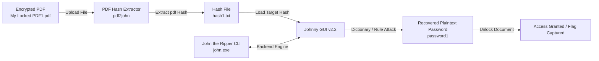

[johnny_2.2_win.zip](https://github.com/user-attachments/files/35099350/johnny_2.2_win.zip)
# NETWORKWALKS-B084-WK3-PM1-PASSWORD-CRACKING-WITH-JTR


<div align="center">

# 🔐 Penetration Testing Lab : Password Cracking with JTR

**Extracting Cryptographic PDF Hashes & Auditing Password Strength with John the Ripper and Johnny GUI**
</div>

<p align="center">


## 📌 Project Overview
This project demonstrates how to audit and recover lost or weak passwords from encrypted PDF documents using **John the Ripper (JTR)** and its graphical user interface, **Johnny**. Originally developed for Unix systems, John the Ripper is a widely used open-source password security auditing and recovery tool capable of cracking various hash formats and password-protected files such as PDFs, ZIP archives, and Office documents on Windows, Linux, and macOS.

---

## 🎯 Purpose of the Lab
The purpose of this laboratory exercise is to simulate real-world password auditing in a controlled environment. By extracting cryptographic hashes from a locked PDF file and running automated dictionary/rule-based attacks, this lab demonstrates how weak passwords expose sensitive files to unauthorized access and reinforces the need for strong authentication controls.

---

## 🚀 Objectives
* **Understand Password Auditing:** Learn how security professionals evaluate password strength and recover access to protected files.
* **Differentiate Encryption vs. Hashing:** Distinguish between reversible two-way encryption and irreversible one-way cryptographic hashing.
* **Hash Extraction:** Extract cryptographic password hashes (`$pdf$...`) from an encrypted PDF file (`My Locked PDF1.pdf`).
* **GUI-Assisted Cracking:** Configure and execute a password cracking attack using Johnny GUI linked to the core `john.exe` binary.
* **Security Awareness:** Identify vulnerabilities caused by low-entropy passwords and implement effective defensive mitigations.

---

## 🏗️ Lab Architecture & Environment
* **Operating System:** Windows PC (or Kali Linux workstation with pre-installed JTR)
* **Core Cracking Engine:** John the Ripper (`v1.9.0-jumbo-1` Windows binaries)
* **Graphical Interface:** Johnny GUI (`v2.2`)
* **Hash Extraction Utility:** Online Hash Crack PDF Hash Extractor (`pdf2john` web utility)
* **Target Asset:** `My Locked PDF1.pdf` (Password-protected PDF document)



---

## 🛠️ Step-by-Step Lab Tasks

### 1. Download John the Ripper (CLI)
* Download the Windows binaries for **John the Ripper** from the official Openwall website <https://www.openwall.com/john/> or the Openwall distribution archive.
* Extract the downloaded archive to a local folder on your PC.


### 2. Download and Install Johnny (GUI)
* Download the **Johnny GUI** installer (`johnny_2.2_win.zip` / `johnnyInstaller.exe`) from the Openwall wiki <https://openwall.info/wiki/john/johnny>.
* Run `johnnyInstaller.exe` and complete the installation wizard.


### 3. Link Johnny GUI to `john.exe`
* Launch **Johnny** from your desktop or Start menu.
* Navigate to the **Settings** tab on the left panel.
* Click **Browse** next to the *John the Ripper executable* field.
* Locate and select `john.exe` inside the extracted JTR `run` folder (e.g., `.../john-1.9.0-jumbo-1-win64/run/john.exe`).
* Verify that Johnny displays the detected JTR version.


### 4. Extract the Hash from the Protected PDF
* Open your browser and navigate to the <https://onlinehashcrack.com>
* Click **Browse**, select the target encrypted file (`My Locked PDF1.pdf`), and click **Upload**.
* Copy the generated hash output string starting with `$pdf$...`.
  > **Note:** Ensure no extra characters (such as `b'` at the beginning or trailing quotes) are copied.


### 5. Save the Hash to a Text File
* Open **Notepad** on your Windows PC.
* Paste the copied `$pdf$...` hash string into the blank document.
* Go to **File > Save As** and save the file as `hash1.txt`.


### 6. Load the Hash File into Johnny
* Return to the **Johnny** application.
* Click **Open password file** on the top toolbar.
* Browse to your saved `hash1.txt` file and click **Open**.


### 7. Execute the Password Cracking Attack
* Click **Start new attack** on the top toolbar.
* Wait for JTR to process the hash against its built-in wordlist and mangling rules.
* Once completed (`100%`), the recovered plaintext password (`good-luck`) will appear in the **Password** column.


### 8. Verify Access to the Encrypted PDF
* Double-click `My Locked PDF1.pdf` to open it in your PDF reader.
* Enter the cracked password (`good-luck`) when prompted.
* Confirm the document unlocks and displays the flag/contents.


---


## 📂 Repository Structure

```text
Password-Cracking-With-JTR/
├── README.md                                              # Project documentation, Mermaid architecture & step-by-step walkthrough
├── hashes/
│   └── hash1.txt                                          # Extracted cryptographic PDF hash (\(pdf\)...)
├── target/
│   └── My Locked PDF1.pdf                                 # Encrypted PDF file audited in the lab
└── screenshots/
    ├── task-01-download-jtr/
    │   ├── 01_john_the_ripper_download.png                # Downloading JTR Windows binaries from Openwall
    │   └── 02_extract_john_jumbo.png                      # Extracting john-1.9.0-jumbo-1-win64 archive
    ├── task-02-install-johnny-gui/
    │   ├── 03_johnny_gui_download.png                     # Downloading Johnny v2.2 Windows installer
    │   ├── 04_johnny_setup_welcome.png                    # Launching Johnny setup wizard
    │   ├── 05_johnny_installation_license.png             # Accepting installation terms
    │   ├── 06_johnny_components.png                       # Selecting Johnny installation components
    │   ├── 07_johnny_start_menu_shortcut.png              # Configuring Start Menu shortcut
    │   ├── 08_johnny_ready_to_install.png                 # Confirming installation settings
    │   └── 09_johnny_installation_finish.png              # Completing Johnny GUI installation
    ├── task-03-link-john-executable/
    │   ├── 10_johnny_open.png                             # Opening Johnny GUI interface
    │   ├── 11_select_john_exe.png                         # Browsing to john.exe inside JTR run folder
    │   └── 12_john_exe_linked_in_settings.png             # Verifying detected JTR version in Settings
    ├── task-04-extract-pdf-hash/
    │   ├── 13_open_hash_website_upload_pdf.png            # Navigating to Online Hash Crack PDF extractor
    │   ├── 14_selecting_pdf1_file.png                     # Selecting My Locked PDF1.pdf for upload
    │   ├── 15_successful_pdf1_upload.png                  # Uploading encrypted PDF to hash extractor
    │   ├── 16_pdf_hash_output.png                         # Generating cryptographic \(pdf\) hash string
    │   └── 17_pdf1_hash_output_copy.png                   # Copying clean \(pdf\) hash string
    ├── task-05-save-hash-to-file/
    │   ├── 18_open_notepad.png                            # Opening Windows Notepad
    │   ├── 19_paste_pdf1_output_notepad.png               # Pasting extracted hash into Notepad
    │   ├── 20_pdf1_output_pasted_verified.png             # Verifying no extra characters exist
    │   ├── 21_save_pdf1_output_dialog.png                 # Opening Save As dialog
    │   └── 22_save_as_hash1_txt.png                       # Saving hash file as hash1.txt
    ├── task-06-load-hash-in-johnny/
    │   ├── 23_open_johnny_again.png                       # Returning to Johnny GUI
    │   ├── 24_click_open_password_file.png                # Clicking Open password file on toolbar
    │   └── 25_browse_to_hash1_txt_open.png                # Loading hash1.txt into Johnny session
    ├── task-07-execute-cracking-attack/
    │   ├── 26_click_start_new_attack.png                  # Starting JTR dictionary/rule attack
    │   └── 27_pdf1_cracked_successful.png                 # Password cracked (good-luck) at 100%
    └── task-08-verify-pdf-access/
        ├── 28_open_encrypted_pdf_file.png                 # Opening My Locked PDF1.pdf in PDF reader
        ├── 29_enter_cracked_password_good_luck.png        # Entering recovered password (good-luck)
        └── 30_flag_captured_successfully.png              # PDF unlocked and flag captured
```


## 🧠 Key Takeaways & Defensive Mitigations
* **Encryption vs. Hashing:** Encryption is a reversible two-way function requiring a decryption key, whereas hashing is a one-way mathematical function producing a unique message digest.
* **Vulnerability of Weak Passwords:** Simple dictionary words or predictable patterns (like `password1`) can be cracked within seconds once a file's hash is extracted.
* **Strong Password Policies:** Enforce high-entropy passwords (14+ characters combining uppercase, lowercase, numbers, and special symbols) to resist dictionary and brute-force attacks.
* **Modern Encryption Standards:** Protect sensitive documents using strong encryption algorithms (such as AES-256) and avoid uploading confidential files to third-party online hash extractors in real-world scenarios—prefer local utilities like `pdf2john.pl` or `pdf2john.py`.

---

## 🔐 Security & Ethical Use
This laboratory and repository are intended strictly for educational and authorized research purposes only. All password auditing activities were conducted within the authorized <https://networkwalks.com> lab scope. Unauthorized cracking or exploitation of external files and systems is illegal.

## 🔗 Tools & Resources
* **Primary Environment:** Windows PC / Kali Linux Workstation <https://networkwalks.com> Week 3 | Project Module 1)
* **Cracking & Extraction Suite:** `John the Ripper (JTR)`, `Johnny GUI`, `pdf2john`
* **Official Documentation:** [Openwall John the Ripper](https://openwall.com) | [Kali Linux Tools Reference](https://kali.org)

## 👤 Author
**Anderson Edaiyo Uzezi**  
Cybersecurity Professional B084  
LinkedIn: https://linkedin.com

