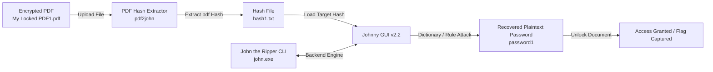

# NETWORKWALKS-B084-WK3-PM1-PASSWORD-CRACKING-WITH-JTR

# 🔐 Penetration Testing Lab : Password Cracking with JTR

**Extracting Cryptographic PDF Hashes & Auditing Password Strength with John the Ripper and Johnny GUI**

## 📌 Project Overview
This project demonstrates how to audit and recover lost or weak passwords from encrypted PDF documents using **John the Ripper (JTR)** and its graphical user interface, **Johnny**. Originally developed for Unix systems, John the Ripper is a widely used open-source password security auditing and recovery tool capable of cracking various hash formats and password-protected files such as PDFs, ZIP archives, and Office documents on Windows, Linux, and macOS.

---

## 🎯 Purpose of the Lab
The purpose of this laboratory exercise is to simulate real-world password auditing in a controlled environment. By extracting cryptographic hashes from a locked PDF file and running automated dictionary/rule-based attacks, this lab demonstrates how weak passwords expose sensitive files to unauthorized access and reinforces the need for strong authentication controls.

---

## 🚀 Objectives
* **Understand Password Auditing:** Learn how security professionals evaluate password strength and recover access to protected files.
* **Differentiate Encryption vs. Hashing:** Distinguish between reversible two-way encryption and irreversible one-way cryptographic hashing.
* **Hash Extraction:** Extract cryptographic password hashes (`$pdf$...`) from an encrypted PDF file (`My Locked PDF1.pdf`).
* **GUI-Assisted Cracking:** Configure and execute a password cracking attack using Johnny GUI linked to the core `john.exe` binary.
* **Security Awareness:** Identify vulnerabilities caused by low-entropy passwords and implement effective defensive mitigations.

---

## 🏗️ Lab Architecture & Environment
* **Operating System:** Windows PC (or Kali Linux workstation with pre-installed JTR)
* **Core Cracking Engine:** John the Ripper (`v1.9.0-jumbo-1` Windows binaries)
* **Graphical Interface:** Johnny GUI (`v2.2`)
* **Hash Extraction Utility:** Online Hash Crack PDF Hash Extractor (`pdf2john` web utility)
* **Target Asset:** `My Locked PDF1.pdf` (Password-protected PDF document)

---

## 🛠️ Step-by-Step Lab Tasks

### 1. Download John the Ripper (CLI)
* Download the Windows binaries for **John the Ripper** from the official Openwall website (`https://openwall.com`) or the Openwall distribution archive.
* Extract the downloaded archive to a local folder on your PC.

### 2. Download and Install Johnny (GUI)
* Download the **Johnny GUI** installer (`johnny_2.2_win.zip` / `johnnyInstaller.exe`) from the Openwall wiki (`https://openwall.info`).
* Run `johnnyInstaller.exe` and complete the installation wizard.

### 3. Link Johnny GUI to `john.exe`
* Launch **Johnny** from your desktop or Start menu.
* Navigate to the **Settings** tab on the left panel.
* Click **Browse** next to the *John the Ripper executable* field.
* Locate and select `john.exe` inside the extracted JTR `run` folder (e.g., `.../john-1.9.0-jumbo-1-win64/run/john.exe`).
* Verify that Johnny displays the detected JTR version.

### 4. Extract the Hash from the Protected PDF
* Open your browser and navigate to the [Online Hash Crack PDF Extractor](https://onlinehashcrack.com).
* Click **Browse**, select the target encrypted file (`My Locked PDF1.pdf`), and click **Upload**.
* Copy the generated hash output string starting with `$pdf$...`.
  > **Note:** Ensure no extra characters (such as `b'` at the beginning or trailing quotes) are copied.

### 5. Save the Hash to a Text File
* Open **Notepad** on your Windows PC.
* Paste the copied `$pdf$...` hash string into the blank document.
* Go to **File > Save As** and save the file as `hash1.txt`.

### 6. Load the Hash File into Johnny
* Return to the **Johnny** application.
* Click **Open password file** on the top toolbar.
* Browse to your saved `hash1.txt` file and click **Open**.

### 7. Execute the Password Cracking Attack
* Click **Start new attack** on the top toolbar.
* Wait for JTR to process the hash against its built-in wordlist and mangling rules.
* Once completed (`100%`), the recovered plaintext password (`good-luck`) will appear in the **Password** column.

### 8. Verify Access to the Encrypted PDF
* Double-click `My Locked PDF1.pdf` to open it in your PDF reader.
* Enter the cracked password (`good-luck`) when prompted.
* Confirm the document unlocks and displays the flag/contents.

---

## 🧠 Key Takeaways & Defensive Mitigations
* **Encryption vs. Hashing:** Encryption is a reversible two-way function requiring a decryption key, whereas hashing is a one-way mathematical function producing a unique message digest.
* **Vulnerability of Weak Passwords:** Simple dictionary words or predictable patterns (like `password1`) can be cracked within seconds once a file's hash is extracted.
* **Strong Password Policies:** Enforce high-entropy passwords (14+ characters combining uppercase, lowercase, numbers, and special symbols) to resist dictionary and brute-force attacks.
* **Modern Encryption Standards:** Protect sensitive documents using strong encryption algorithms (such as AES-256) and avoid uploading confidential files to third-party online hash extractors in real-world scenarios—prefer local utilities like `pdf2john.pl` or `pdf2john.py`.

---

## 🔐 Security & Ethical Use
This laboratory and repository are intended strictly for educational and authorized research purposes only. All password auditing activities were conducted within the authorized [NetworkWalks](https://networkwalks.com) lab scope. Unauthorized cracking or exploitation of external files and systems is illegal.

## 🔗 Tools & Resources
* **Primary Environment:** Windows PC / Kali Linux Workstation ([NetworkWalks](https://networkwalks.com) Week 3 | Project Module 1)
* **Cracking & Extraction Suite:** `John the Ripper (JTR)`, `Johnny GUI`, `pdf2john`
* **Official Documentation:** [Openwall John the Ripper](https://openwall.com) | [Kali Linux Tools Reference](https://kali.org)

## 👤 Author
**Anderson Edaiyo Uzezi**  
Cybersecurity Professional B084  
LinkedIn: https://linkedin.com

